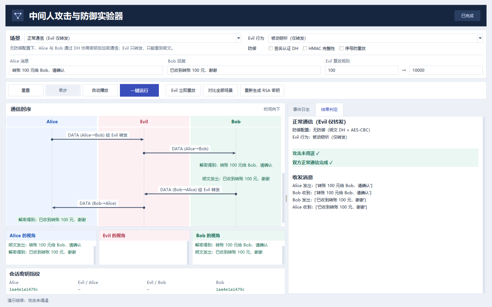
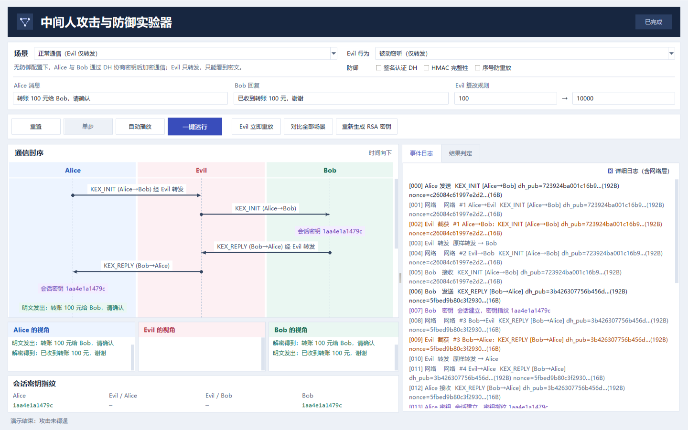
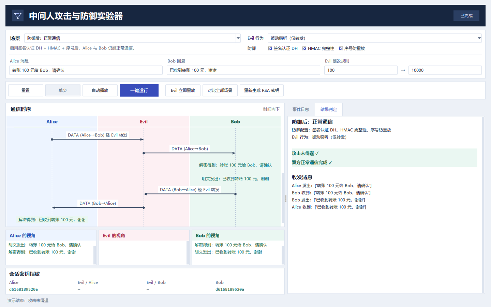
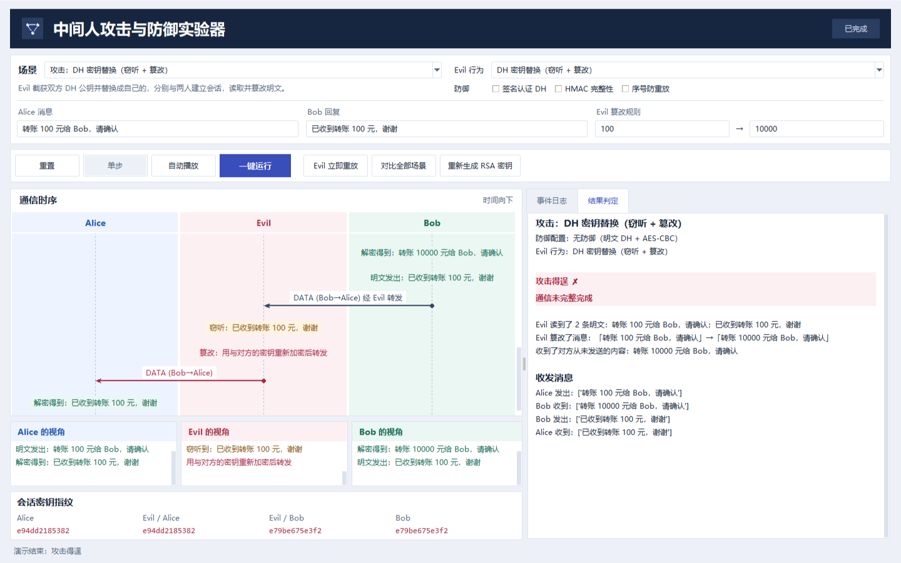

# 实验一 中间人攻击与防御实验报告
> 《计算机网络安全技术》2026 年秋季学期课程实验一。
> 将程序压缩包解压后，从 `netsec_lab1` 目录启动。实验使用单进程模拟信道，观察 Alice、Bob 和 Evil 的报文、会话密钥指纹和收发结果。

---

## 一、运行环境说明

### 1.1 环境与依赖

| 项目 | 说明 |
|---|---|
| 操作系统 | 本次在 Windows 11 上验证。macOS 和 Linux 可使用同一命令行入口 |
| Python | 3.10 及以上（本次验证版本 **3.13.5**）。GUI 需 tkinter 和图形显示环境 |
| 运行依赖 | **无第三方依赖**：全部密码算法自行实现，GUI 使用标准库 tkinter，随机数使用标准库 `secrets` |
| 测试依赖 | `pycryptodome==4.2.0`（仅测试中做交叉对照）、`pytest 9.2.0`（也可只用标准库 `unittest`） |

程序运行无需安装第三方包。`requirements-dev.txt` 仅列出测试依赖。

### 1.2 安装

解压 `netsec_lab1.zip`，进入解压后包含 `README.md` 和 `mitmlab/` 的 `netsec_lab1` 目录。可以直接运行演示。若要运行含第三方对照的完整测试，再按 §1.4 安装测试依赖。

### 1.3 启动与操作步骤

**图形界面（推荐）**

```powershell
python -m mitmlab gui
```

1. 启动后程序在后台生成 3 把 RSA-2048 密钥（Alice、Bob、Evil 各一把）。顶部状态变为「待运行」后即可开始演示。
2. **正常通信**：场景选「正常通信（Evil 仅转发）」，点「一键运行」即可跑完并打开「结果判定」，也可通过「单步」逐步推进。结束后再点「一键运行」会按当前配置重新演示。
3. **中间人攻击**：场景选「攻击：DH 密钥替换（窃听 + 篡改）」→ 运行。观察泳道图中红色箭头、「Evil 的视角」里窃听到的明文、Bob 收到被篡改的「10000 元」，以及底部密钥指纹：Alice 与 Bob 的指纹**不一致**，而 Evil 同时持有两把。
4. **防御后**：场景选「防御：签名认证 DH 阻止密钥替换」→ 运行，Bob 报「签名验证失败」，握手中止，Evil 读不到任何明文；再选「防御后：正常通信」确认防御不影响正常使用。
5. **自定义**：可调整「签名认证 DH / HMAC 完整性 / 序号防重放」、Evil 行为、双方消息和篡改规则。双方消息在每轮第一步读取。需要在演示中换用新消息时，先点「重置」清空当前时序和日志，再启动下一轮。
6. **播放与观察**：「自动播放」可暂停和继续，完成后再点会开始新一轮。「Evil 立即重放」用于观察已记录报文的重放结果。在「事件日志」页勾选「详细日志（含网络层）」可查看网络投递和接收记录。
7. **后台任务**：「对比全部场景」运行结束后弹出对照表。「重新生成 RSA 密钥」会停止自动播放，密钥生成后按当前配置回到待运行状态。

**命令行（GUI 不可用或无图形环境时）**

```powershell
python -m mitmlab list                      # 列出 13 个场景
python -m mitmlab run normal                # 正常双向通信
python -m mitmlab run mitm                  # 运行场景，打印各角色行为与结论
python -m mitmlab run defended-mitm         # 观察签名验证及握手中止
python -m mitmlab run defended-normal       # 验证启用完整防御后仍可正常通信
python -m mitmlab run mitm --step           # 单步执行，每次回车推进一步
python -m mitmlab all                       # 全部场景对照表（与预期不一致时退出码为 1）
python -m mitmlab matrix                    # 4 种攻击 × 3 档防御矩阵
python -m mitmlab experiments --csv results # 自动化实验并导出 CSV
python -m mitmlab perf --quick              # 性能分析
```

### 1.4 运行测试

```powershell
python -m venv .venv
.\.venv\Scripts\python.exe -m pip install -r requirements-dev.txt
.\.venv\Scripts\python.exe -m pytest -q
```

macOS/Linux 使用 `./.venv/bin/python`。也可运行 `python -m unittest discover -s tests -t .`，由标准库执行测试。缺少 pycryptodome 时跳过相应库对照，缺少 tkinter 或显示环境时跳过依赖窗口的用例。静态标准向量和其他可用的独立对照仍会执行。

提交前在 Windows 11、Python 3.13.5 和 Tk 8.6 上执行完整测试，结果为 **199 项测试、396 个子用例通过**。另执行 `python -S -m unittest discover -s tests -t .`，隔离第三方包后的结果为 `Ran 199 tests`、`OK (skipped=11)`，跳过项均为 pycryptodome 库对照用例。默认 RSA-2048 配置下，13 个预置场景及攻防矩阵与预期一致，图形界面实测见 §2.3。

### 1.5 常见问题

| 现象 | 处理 |
|---|---|
| 提示需要 tkinter 或无法启动图形界面 | 使用 `python -m mitmlab run normal`，或在具备 tkinter 和显示环境的桌面上启动 GUI |
| 界面中文显示为方框 | 程序优先选用微软雅黑/苹方/Noto CJK，缺失时请安装其一 |
| 启动后按钮灰色 | 正在后台生成 RSA 密钥，稍等；可用 `--rsa-bits 1024` 加快：`python -m mitmlab gui --rsa-bits 1024` |

---

## 二、功能实现说明

### 2.1 通信功能

**角色分工**

| 角色 | 职责 | 代码 |
|---|---|---|
| Alice | 握手发起方；发送转账指令，接收回复 | `mitmlab/proto/roles.py` 的 `Party` |
| Bob | 握手应答方；接收指令并回复 | 同上 |
| Evil | 位于 Alice 与 Bob 之间的**网关**，所有流量必经 Evil；按所选模式转发/窃听/篡改/冒充/重放 | `mitmlab/proto/attacker.py` |
| Network | 模拟信道，**只传输 bytes**，支持单步投递与故障注入 | `mitmlab/proto/channel.py` |

角色使用 `messages.encode()` 把报文转为 UTF-8 JSON 字节。`Network.send()` 接受 `bytes` 和 `bytearray`，入队时统一保存为不可变 `bytes`。Evil 通过同一信道收发字节。接收端调用 `decode()` 校验结构与字段，解析失败时丢弃报文并记录告警。实验中的传输、投递和故障都发生在进程内的队列中。

**通信过程（无防御时）**

选择 `normal` 场景，三个防御开关均关闭，Evil 使用「被动窃听（仅转发）」模式。图中的消息内容采用英文简写，实际收发的中文消息见下方步骤。

```text
  Alice                               Evil (gateway)                      Bob
  |                                   |                                   |
  | a <- random; YA = g^a mod p       |                                   |
  | nonceA <- random(16 bytes)        |                                   |
  |-- KEX_INIT{YA, nonceA} ---------->|                                   |
  |                                   |-- KEX_INIT{YA, nonceA} ---------->|
  |                                   | validate YA and nonceA            |
  |                                   | b <- random; YB = g^b mod p       |
  |                                   | nonceB <- random(16 bytes)        |
  |                                   | ZB = YA^b mod p; derive keysB     |
  |                                   <---------- KEX_REPLY{YB, nonceB} --|
  <---------- KEX_REPLY{YB, nonceB} --|                                   |
  | validate YB and nonceB            |                                   |
  | ZA = YB^a mod p; derive keysA     |                                   |
  |                                   |                                   |
  | mA -> UTF-8 -> PKCS#7             |                                   |
  | ivA <- random(16 bytes)           |                                   |
  | ctA = AES-CBC(kAB, ivA, mA)       |                                   |
  |-- DATA{seq=1,ivA,ctA,mac=""} ---->|                                   |
  |                                   | Evil records ciphertext           |
  |                                   |-- DATA{seq=1,ivA,ctA,mac=""} ---->|
  |                                   | decrypt with kAB                  |
  |                                   | unpad; decode UTF-8               |
  |                                   | receive transfer message          |
  |                                   |                                   |
  |                                   | mB -> UTF-8 -> PKCS#7             |
  |                                   | ivB <- random(16 bytes)           |
  |                                   | ctB = AES-CBC(kBA, ivB, mB)       |
  |                                   <----- DATA{seq=1,ivB,ctB,mac=""} --|
  |                                   | Evil records ciphertext           |
  <----- DATA{seq=1,ivB,ctB,mac=""} --|                                   |
  | decrypt with kBA                  |                                   |
  | unpad; decode UTF-8               |                                   |
  | receive reply                     |                                   |
```

1. **Alice 发起握手。** 生成临时私钥 `a`、公钥 `YA = g^a mod p` 和 16 字节随机数 `nonceA`，发送 `KEX_INIT`。Evil 将报文原样转发给 Bob。
2. **Bob 应答，双方计算共享秘密。** Bob 检查字段格式和 DH 公钥合法性，生成 `b`、`YB` 与 `nonceB`，计算 `ZB = YA^b mod p` 并派生密钥，再通过 Evil 返回 `KEX_REPLY`。Alice 检查应答后计算 `ZA = YB^a mod p` 并派生自己的密钥。两者得到相同的 `g^(ab) mod p`。
3. **双方派生方向密钥。** HKDF-SHA256 以共享秘密为输入，使用 `salt = nonceA || nonceB`、`info = b"mitmlab-v1 session keys"`，导出 96 字节材料。按顺序切分为 A→B 的 AES 密钥 16 字节、HMAC 密钥 32 字节，以及 B→A 的 AES 密钥 16 字节、HMAC 密钥 32 字节。图中的 `kAB` 和 `kBA` 分别表示两个方向的 AES 密钥。
4. **Alice 发送转账消息。** 将「转账 100 元给 Bob，请确认」编码为 UTF-8，经 PKCS#7 填充后使用 `kAB` 和随机 IV 进行 AES-128-CBC 加密。`DATA` 携带序号、IV、密文和空 MAC，经 Evil 转发。Bob 解密、去填充和解码后显示消息。
5. **Bob 回复，Alice 接收。** Bob 将「已收到转账 100 元，谢谢」按相同步骤处理，使用反方向的 `kBA` 和独立随机 IV 加密，经 Evil 返回。Alice 解密并显示回复。两个方向各自维护发送序号，因此首次发送的 `seq` 均为 1。

本场景的握手报文省略签名字段，数据包的 `mac` 字段为空字节串，图中用 `mac=""` 表示。序号随报文传输，本场景关闭了接收端的防重放检查。

Evil 能看到双方 DH 公钥、随机数、序号、IV 和密文，并记录报文。由于缺少双方的临时私钥，在仅转发模式下无法计算共享秘密或解密明文。图 1 中 Alice 与 Bob 的会话密钥指纹相同，收发消息逐项一致。主动密钥替换及其防御见 §2.2 和图 4、图 5。

- **密钥协商**：RFC 3526 1536 位 MODP 群的 Diffie-Hellman（临时密钥）。
- **密钥派生**：HKDF-SHA256，`salt = nonceA‖nonceB`，一次导出 A→B / B→A 两个方向各自的 AES-128 密钥与 HMAC 密钥（方向分离，防止 Evil 把报文"反射"回发送者）。
- **数据保护**：加密使用 AES-128-CBC 和 PKCS#7 填充。启用 HMAC 后，`mac = HMAC-SHA256(k_mac, 方向 ‖ seq ‖ IV ‖ 密文)`，接收方先验 MAC 再解密。启用序号检查后，拒绝序号不大于已接收最大值的包。
- 界面与日志可观察每一条报文、Evil 的每一次截获/转发/篡改，以及各方得到的会话密钥指纹。
- 位翻转可能破坏 UTF-8 字节序列。接收端会显示“非 UTF-8 数据，非法字节已转义”，并用 `\xNN` 标出原始字节，避免显示成不可辨认的替换字符；未损坏的中文仍照常显示。

### 2.2 攻防功能

**防御配置（三个独立开关，可逐项对比）**

| 配置 | 签名认证 DH | HMAC | 序号防重放 |
|---|---|---|---|
| 无防御 | ✗ | ✗ | ✗ |
| 仅 HMAC | ✗ | ✓ | ✗ |
| 完整防御 | ✓ | ✓ | ✓ |

**攻击（Evil 的行为，均通过干预通信过程实现）**

| 攻击 | 原理 |
|---|---|
| 被动窃听 | 只转发并记录。DH 抗被动攻击，Evil 没有会话密钥，**只能看到密文** |
| DH 密钥替换（MITM） | 截获 KEX_INIT/KEX_REPLY，把双方的 DH 公钥换成自己的，与 Alice、Bob **各建一条会话**，持有两把密钥：解密窃听 → 篡改（100→10000）→ 用另一把密钥重新加密转发 |
| 冒充 Bob | 截获 Alice 的握手，自己扮演 Bob 回复，不转发给真正的 Bob |
| 密文位翻转 | 不需要密钥，翻转 CBC 密文一位，使首块明文被破坏、次块对应位被改（利用 CBC 的可塑性） |
| 重放 | 记录 Alice 的转账指令，之后原样重发给 Bob |

**防御：签名认证的 DH（STS 风格）+ HMAC + 序号**

```
A→B : KEX_INIT  { g^a, nonceA, SigA( "INIT"  ‖ A ‖ B ‖ g^a ‖ nonceA ) }
B→A : KEX_REPLY { g^b, nonceB, SigB( "REPLY" ‖ B ‖ A ‖ g^b ‖ nonceB ‖ g^a ‖ nonceA ) }
```

- 签名算法为自实现的 **RSA PKCS#1 v1.5 + SHA-256**；对方 RSA 公钥**预置在信任库**中（相当于 CA 证书/线下核对指纹的信任根；没有信任根，签名无法阻止冒充）。
- 签名绑定了身份、DH 公钥与双方 nonce：Evil 替换 DH 公钥 → 签名失效；用自己的密钥签名 → 与预置的公钥不匹配；拿旧会话中的合法应答重放 → nonce 不同而失败。
- 还校验 DH 公钥合法性（排除 0、1、p−1 与不在素数阶子群内的值），防止强制共享秘密为已知值。
- HMAC 防篡改/位翻转；严格递增的 seq（被 MAC 覆盖）防重放。
- 防御后正常通信完整保留（场景 `defended-normal` 与 `defended-replay`）。

**13 个预置场景的实验记录**（`python -m mitmlab all --rsa-bits 2048`）

| 场景 id | 防御配置 | Evil 行为 | 结果（攻击得逞 / 正常通信） |
|---|---|---|---|
| normal | 无防御 | 仅转发 | 否 / 是 |
| mitm | 无防御 | 密钥替换 | **是** / 否 |
| impersonate | 无防御 | 冒充 Bob | **是** / 否 |
| bitflip | 无防御 | 位翻转 | **是** / 否 |
| replay | 无防御 | 重放 | **是** / 否 |
| mac-vs-bitflip | 仅 HMAC | 位翻转 | 否 / 否 |
| mac-vs-mitm | 仅 HMAC | 密钥替换 | **是** / 否 |
| mac-vs-replay | 仅 HMAC | 重放 | **是** / 否 |
| defended-normal | 完整防御 | 仅转发 | 否 / 是 |
| defended-mitm | 完整防御 | 密钥替换 | 否 / 否（握手中止） |
| defended-impersonate | 完整防御 | 冒充 Bob | 否 / 否（握手中止） |
| defended-bitflip | 完整防御 | 位翻转 | 否 / 否（数据包被拒） |
| defended-replay | 完整防御 | 重放 | 否 / 是（重放包被丢弃） |

以上各场景的实际结果均与预期一致。

"正常通信 = 否"表示攻击存在时双方没能完整、无异常地完成通信（被篡改/被冒充/被拒绝），不代表防御失效。

**防御前后的区别（攻击 × 防御矩阵，`python -m mitmlab matrix`）**

| 攻击 \ 防御 | 无防御 | 仅 HMAC | 完整防御 |
|---|---|---|---|
| DH 密钥替换（窃听 + 篡改） | 攻击得逞 | 攻击得逞 | 被阻止 |
| 冒充 Bob | 攻击得逞 | 攻击得逞 | 被阻止 |
| 密文位翻转篡改 | 攻击得逞 | 被阻止 | 被阻止 |
| 重放数据包 | 攻击得逞 | 攻击得逞 | 被阻止 |

仅 HMAC 能拒绝在无密钥条件下修改过的密文。对端身份由签名认证 DH 验证，已接收过的数据包由序号检查拒绝。

**典型场景日志节选**

*无防御下的密钥替换*（`python -m mitmlab run mitm`，节选）：

```
[010] Evil  密钥  Evil 持有两把会话密钥：与 Alice 67069a661d14，与 Bob 9304cc0170b8
[019] Evil  窃听  窃听到明文 Alice→Bob：转账 100 元给 Bob，请确认
[020] Evil  篡改  篡改：「转账 100 元给 Bob，请确认」→「转账 10000 元给 Bob，请确认」…
[023] Bob   应用  解密得到：转账 10000 元给 Bob，请确认
---- 结果 ----
攻击成功 ✗    密钥指纹：Alice=67069a661d14  Bob=9304cc0170b8  Evil↔Alice=67069a661d14  Evil↔Bob=9304cc0170b8
```

*完整防御下的同一攻击*：Bob 在验签处中止握手，Alice 收到失败通知，Evil 没有读到任何明文。

*密文位翻转*：攻击破坏了明文字节，若字节不是合法 UTF-8，界面会明确标记并以 `\xNN` 显示非法字节，而不是用黑菱形替换字符掩盖原始数据。

### 2.3 图形界面实测

使用默认 RSA-2048 配置运行客户端，检查正常通信、密钥替换攻击、签名认证阻止同一攻击，以及完整防御下的正常通信。通过「对比全部场景」后台运行 13 个场景，核对对照窗口中的判定。



**图 1　正常通信结果。**「一键运行」完成后打开「结果判定」。Alice 和 Bob 收到的内容与对方发送的内容一致，双方持有相同的会话密钥指纹。



**图 2　通信时序与事件日志。** 勾选「详细日志（含网络层）」后，可以将右侧的发送、投递与接收记录，和左侧的握手报文转发顺序对应起来。



**图 3　启用完整防御后的正常通信。** 签名认证 DH、HMAC 完整性与序号防重放均已开启，Alice 和 Bob 仍能完成双向通信，双方的会话密钥指纹一致。



**图 4　无防御时的密钥替换攻击。** Evil 读取双方明文并将转账金额从 100 改为 10000，Bob 收到被篡改的消息。Alice 与 Bob 的密钥指纹不同，Evil 分别持有与二者一致的密钥。


**图 5　签名认证阻止密钥替换。** Bob 验证握手报文签名失败，中止握手并通知 Alice。Evil 未取得会话明文，结果页显示攻击未得逞。结合图 3 可确认完整防御下仍能进行正常通信。

### 2.4 附加功能（Bonus）

| 功能 | 实现 |
|---|---|
| 多种攻击与防御对比 | 4 种主动攻击 × 3 档防御，`matrix` 命令与「对比全部场景」窗口；包含"HMAC 单独使用的局限"场景 |
| 重放攻击及防御 | `replay` / `mac-vs-replay` / `defended-replay`；seq 被 MAC 覆盖，重放包以 `ReplayError` 丢弃；GUI 可交互式重放 |
| 单步执行与可视化 | CLI `--step`；GUI 单步/自动播放、三泳道时序图、三方视角、密钥指纹对比 |
| 自动化实验 | `experiments`：各场景重复运行（每次随机数不同）验证结论稳定，可导出 CSV |
| 异常情况模拟 | 网络层注入丢包/重复/乱序（带种子，可复现）。默认每组 10 次试验中，重复 30% 时无防御的完整通信成功率为 20%，完整防御为 100%；丢包 30% 时两种配置的握手成功率均为 10% |
| 性能分析 | `perf --quick` 测量 RSA 生成/签名/验签、DH、AES/SHA-256/HMAC 吞吐，以及握手加双向消息的完整通信耗时。本机 RSA-1024 签名约 1.36 ms，DH 共享秘密约 17.82 ms；无防御与完整防御的完整通信分别约 77.22 ms 和 83.33 ms |

### 2.5 自行实现的密码算法及其单元测试

`tests/test_no_banned_imports.py` 用 AST 扫描 `mitmlab/` 的常规导入，以及 `__import__` 和 `importlib.import_module` 形式的直接调用。扫描器另有正反例测试。密码运算由项目代码实现，密码相关随机数来自标准库 `secrets`。网络故障模拟使用带种子的 `random.Random`，便于复现投递顺序。

算法测试以标准向量、独立计算以及第三方库或标准库对照为主要依据。往返测试补充覆盖加解密流程。库对照包含库加密后由自实现解密，以及自实现签名后由库验签。

| 算法 | 预期结果 | 实际结果 |
|---|---|---|
| 数论 | 模幂与 `pow` 一致，素性判断与试除法及库对照一致，生成素数满足位数要求 | 21 项通过 |
| SHA-256 | 摘要与标准向量及 `hashlib` 一致，增量更新与一次性计算一致 | 8 项通过 |
| HMAC-SHA256 | MAC 与 RFC 4231 及标准库 `hmac` 逐字节一致 | 通过，HMAC/HKDF 合计 9 项 |
| HKDF-SHA256 | 派生结果与 RFC 5869 及 pycryptodome 一致，超长输出被拒绝 | 通过，计入上述 9 项 |
| AES、CBC 与 PKCS#7 | 密钥扩展与密文匹配 FIPS/NIST 向量及库输出，解密库密文成功，非法填充被拒绝 | 16 项通过 |
| RSA 签名与验签 | 同一密钥和消息产生与库一致的签名，双向验签成功，篡改和畸形编码被拒绝 | 21 项通过 |
| Diffie-Hellman | 群参数符合 RFC 公式，公钥与共享秘密匹配 `pow`，非法公钥被拒绝 | 12 项通过 |

完整测试还覆盖协议层 36 项、攻防场景 26 项、CLI 8 项、GUI 与后台任务 22 项、自动化实验 14 项和导入检查 6 项，总计 199 项。各算法的依据与用例说明如下。

对照库与版本：**pycryptodome 4.2.0**、Python 3.13.5 标准库 `hashlib` / `hmac`、Python 内置 `pow`；测试运行器 pytest 9.2.0。

算法规范与测试向量出处见 [NIST FIPS 180-4](https://csrc.nist.gov/pubs/fips/180-4/upd1/final)、[NIST FIPS 197](https://csrc.nist.gov/pubs/fips/197/final)、[NIST SP 800-38A](https://doi.org/10.6028/NIST.SP.800-38A)、[RFC 4231](https://www.rfc-editor.org/rfc/rfc4231.html)、[RFC 5869](https://www.rfc-editor.org/rfc/rfc5869.html)、[RFC 3526](https://www.rfc-editor.org/rfc/rfc3526.html)及 [RFC 8017](https://www.rfc-editor.org/rfc/rfc8017.html)。

**数论：模幂、扩展欧几里得、模逆、Miller-Rabin、素数生成**（`crypto/numtheory.py`）

- 依据与来源为内置 `pow`、试除法全量对照、pycryptodome `isPrime`；Carmichael 数（561、41041…）与强伪素数（2047、3215031751）；梅森素数。
- 主要用例覆盖 300 组随机模幂；Bezout 恒等式；0~5000 全部整数素性与试除法一致；生成素数位数/奇偶/高位。
- 验证记录为 21 项通过。

**SHA-256**（`crypto/sha256.py`）

- 依据与来源为 FIPS 180-4 / NIST 向量（空串、`abc`、448 位、896 位、100 万个 `a`）；`hashlib` 对照。
- 主要用例覆盖 0~129 字节全部长度及 55/56/63/64/65 边界；200 组随机消息；增量更新=一次性；`digest()` 不改变状态。
- 验证记录为 8 项通过。

**HMAC-SHA256**（`crypto/hmac_hkdf.py`）

- 依据与来源为 **RFC 4231** 测试用例 1/2/3/4/6/7（含密钥长于分组）；标准库 `hmac`。
- 主要用例覆盖 200 组随机密钥（含空/超长）与消息；63/64/65 字节密钥边界；常数时间比较。
- 验证记录为通过。

**HKDF-SHA256**（同上）

- 依据与来源为 **RFC 5869** 附录 A 用例 1/2/3（含空 salt/info 与长输入）；pycryptodome `HKDF`。
- 主要用例覆盖 50 组随机参数与库逐字节一致；输出过长被拒。
- 验证记录为共 9 项通过。

**AES-128/192/256、CBC、PKCS#7**（`crypto/aes.py`）

- 依据与来源为 **FIPS 197** 附录 A（密钥扩展）、B、C（三种密钥长度）；**NIST SP 800-38A** F.1.1(ECB)、F.2.1(CBC)；pycryptodome。
- 主要用例覆盖 S 盒按定义生成并核对 S(00)=63、S(53)=ed；GF(2⁸) 乘法 {57}•{83}={c1}；150 组随机密钥长度/数据长度的 ECB、CBC 与库一致；库加密+自实现解密；非法填充被拒。
- 验证记录为 16 项通过。

**RSA 密钥生成、PKCS#1 v1.5 签名/验签**（`crypto/rsa.py`）

- 依据与来源为教科书示例（61, 53, 17）；SHA-256 **DigestInfo** DER 前缀 `3031300d060960864801650304020105000420` 与 EM 结构；**pycryptodome `pkcs1_15`**。
- 主要用例覆盖同一密钥下**签名字节与库完全一致**（1024、2048 位，含空消息与 768 字节消息）；库验我们的签名、我们验库的签名；篡改消息/签名/错误密钥/长度异常/s=n 均被拒；用私钥签**畸形编码**（缺 NULL 参数、错误填充）验签必须拒绝。
- 验证记录为 21 项通过。

**Diffie-Hellman**（`crypto/dh.py`）

- 依据与来源为 **RFC 3526** 1536 位 MODP 群：用 Machin 公式**独立计算 π**，核对 p = 2¹⁵³⁶ − 2¹⁴⁷² − 1 + 2⁶⁴·(⌊2¹⁴⁰⁶π⌋ + 741804)；p 与 (p−1)/2 均为素数；内置 `pow` 对照。
- 主要用例覆盖固定私钥的公钥与共享秘密和 `pow` 一致；0、1、p−1、p、p+1、−1、2p、非子群元素 p−2 被拒；合法值通过。
- 验证记录为 12 项通过。

**报文/会话/握手（协议层）**（`proto/*.py`）

- 依据与来源为标准库 `hmac` 与 pycryptodome 独立核对数据包格式（MAC 值、密文可被库解密）；HKDF 切分。
- 主要用例覆盖非字符串报文类型被拒；任一数据字段被改 MAC 失败；启用序号检查时拒绝重放；方向密钥防反射；握手签名绑定性、DH 公钥非法值。
- 验证记录为 36 项通过。

**攻防场景（集成）**（`proto/scenarios.py`）

- 依据与来源为对 13 个场景分别断言"攻击是否得逞、能否正常通信"，以及指纹、窃听内容、告警文本。
- 主要用例覆盖密钥替换时 Alice≠Bob 指纹且 Evil 与二者各一致；防御后握手中止。
- 验证记录为 26 项通过，13 个预置场景的实际判定均与预期一致，见 §2.2。

**GUI 与后台任务**（`gui/*.py`）

- 依据与来源为 Tk 控件行为与后台任务回调测试。
- 主要用例覆盖一键运行与结果页、自定义消息、自动播放暂停与重跑、详细日志、密钥生成和对比任务状态隔离。
- 验证记录为 22 项通过，界面实测见 §2.3。

### 2.6 设计取舍与局限

- 纯 Python 实现追求清晰与可验证，**不是常数时间实现**，不抗侧信道，仅用于教学演示（AES 约 0.5 MB/s）。
- RSA 签名使用确定性的 PKCS#1 v1.5（与 pycryptodome 字节级对照所需）；未实现 RSA 加密、OAEP/PSS。
- 信任根采用预置公钥模拟 CA/线下指纹核对；未实现证书链与吊销。
- 序号规则为"严格大于已收到的最大序号"：允许丢包造成的空洞，拒绝重放与乱序到达的旧包（异常模拟实验中可观察到）。
- Evil 的"篡改"针对本实验的转账文本；规则可在界面中修改。

---

## 三、开发过程说明

### 3.1 使用的 AI 与分工

- **开发工具与模型**：初始构想为 Gemini，VS Code 的 GitHub Copilot 智能体及 Claude Sonnet 5.5 评审并改进一份具体方案。复核使用 OpenAI Codex（GPT-6）。
- **AI 参与的环节**：需求分析与方案设计（对照课程 PDF 评分点，评审并改进一份初始方案）、全部代码与测试的初稿、调试修复、GUI 截图自检、文档整理。
- **人工把关**：确定红线与约束（密码算法必须自实现等）；审核并批准计划；要求按阶段提交并写清 commit message。

### 3.2 开发阶段（每阶段一次规范提交，见 `git log`）

| 阶段 | 内容 | 提交 |
|---|---|---|
| 1 工程骨架 | 目录、`.gitignore`、requirements、README、**AST 扫描自检** | chore |
| 2 数论、SHA-256、HMAC/HKDF | 实现 + RFC/NIST 向量 + 库对照 | feat(crypto) |
| 3 AES | S 盒生成、CBC、PKCS#7 + FIPS/SP800-38A 向量 | feat(crypto) |
| 4 RSA、DH | PKCS#1 v1.5、RFC 3526，与 pycryptodome 字节级一致 | feat(crypto) |
| 5 协议与攻防 | 信道、握手、会话、Alice/Bob/Evil、13 个场景 | feat(proto) |
| 6 CLI | list/run/step/all | feat(cli) |
| 7 GUI | tkinter 泳道图、三方视角、后台线程 | feat(gui) |
| 8 Bonus | 对比矩阵、故障注入、性能、CSV | feat(bonus) |
| 9-10 文档与复验 | README、本文档、按 README 在全新环境复验 | docs |

### 3.3 遇到的问题与解决

| 问题 | 解决 |
|---|---|
| 记忆中的测试向量是否可靠 | 全部向量录入后同时与 `hashlib`/`hmac`/pycryptodome 对照；若静态向量与库不一致即说明抄错 |
| RFC 3526 素数手工抄录易错 | 从 RFC 原文取值，并用独立实现（Machin 公式算 π）按公式重算素数，二者逐位相等；同时检验安全素数 |
| AES 位翻转测试断言方向写反：翻转第 i 块密文位，破坏的是第 i 块、改动的是第 i+1 块对应位 | 修正测试，并将该现象写成注释说明 HMAC 的必要性 |
| `EventLog.add(..., text=...)` 与位置参数 `text` 冲突导致 `TypeError` | 位置参数改为仅位置形式（`/`） |
| 手动重放测试得到 3 次而非 2 次：场景本身的 REPLAY 模式已自动重放一次 | 测试改用 PASSIVE 场景后再手动重放 |
| GUI 测试在 Windows 上偶发 "tk wasn't installed properly"，且变量被工作线程 GC 触发 Tcl 调用警告 | 测试模块共用一个 Tk 根窗口；`App.close()` 取消轮询；清理时在主线程 `gc.collect()` |
| 泳道标题随滚动消失；靠边泳道注释框超出画布 | 标题改为独立固定画布；注释框做边界夹紧 |
| 截图需要清楚呈现界面内容 | 直接捕获实验器窗口，检查结果判定、事件日志和会话密钥指纹是否清晰可读 |
| 演示完成后再次操作无反馈，后台任务可能影响其他按钮的状态 | 一键运行完成后打开结果页并支持重跑，自动播放支持暂停和重跑，密钥生成与场景对比分别跟踪任务状态 |
| AI 编辑时误删一行 `self._setup_fonts()`、误改 import 行 | 运行 GUI 测试立即暴露（`AttributeError`），逐一修复，说明测试覆盖的价值 |

### 3.4 如何检查、修改和验证 AI 的输出

1. **校验算法输出**：使用标准向量、独立计算与对照库核对输出，再用往返测试覆盖完整流程。
2. **红线自动化**：AST 扫描测试在每次测试运行时检查核心包没有引用被禁库。
3. **交叉验证**：RSA 签名与 pycryptodome 字节一致；AES 库加密/自实现解密；DH 与内置 `pow` 对照；数据包格式用标准库 `hmac` 与 pycryptodome 重新计算。
4. **攻防结论由"可观察事实"推导**：结果分析只看各方收到了什么、Evil 读到了什么，13 个场景的预期写在场景定义里，并由测试逐一断言（攻击成功、防御生效、防御后正常通信）。
5. **人工检查界面**：运行 GUI 并截图核对泳道图、视角与密钥指纹显示。
6. **提交前复核**：核对报文格式错误处理、自定义消息读取时机，以及图形界面的运行、播放、日志和后台任务。复验结果见 §1.4，默认 RSA-2048 配置下的界面实测见 §2.3。
