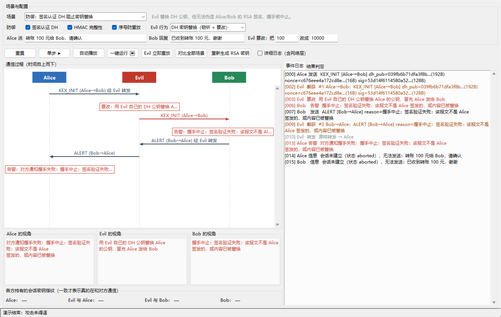

# 实验一：中间人攻击与防御实验器 —— 实验说明文档

> 《计算机网络安全技术》2026 年秋季学期课程实验一。
> 项目目录：`netsec_lab1`；入口：`python -m mitmlab gui`（图形界面）/ `python -m mitmlab …`（命令行）。

---

## 一、运行环境说明

### 1.1 环境与依赖

| 项目 | 说明 |
|---|---|
| 操作系统 | Windows 11（开发与验证环境）；macOS / Linux 同样可用 |
| Python | 3.10 及以上（开发验证版本 **3.13.5**），需包含 tkinter（官方安装包默认自带） |
| 运行依赖 | **无第三方依赖**：全部密码算法自行实现，GUI 使用标准库 tkinter，随机数使用标准库 `secrets` |
| 测试依赖 | `pycryptodome==4.2.0`（仅测试中做交叉对照）、`pytest 9.2.0`（也可只用标准库 `unittest`） |

依赖文件：`requirements.txt`（运行，为空）、`requirements-dev.txt`（测试）。

### 1.2 安装

```powershell
cd netsec_lab1
python -m venv .venv
.\.venv\Scripts\Activate.ps1            # macOS/Linux: source .venv/bin/activate
pip install -r requirements-dev.txt     # 仅为运行测试；只想运行程序可跳过
```

### 1.3 启动与操作步骤

**图形界面（推荐）**

```powershell
python -m mitmlab gui
```

1. 启动后程序在后台线程生成 3 把 RSA-2048 密钥（Alice/Bob/Evil 各一把，约数秒），状态栏提示完成后按钮才可用。
2. **正常通信**：场景选「正常通信（Evil 仅转发）」→ 点「一键运行」或反复点「单步」。
3. **中间人攻击**：场景选「攻击：DH 密钥替换（窃听 + 篡改）」→ 运行。观察泳道图中红色箭头、「Evil 的视角」里窃听到的明文、Bob 收到被篡改的「10000 元」，以及底部密钥指纹：Alice 与 Bob 的指纹**不一致**，而 Evil 同时持有两把。
4. **防御后**：场景选「防御：签名认证 DH 阻止密钥替换」→ 运行，Bob 报「签名验证失败」，握手中止，Evil 读不到任何明文；再选「防御后：正常通信」确认防御不影响正常使用。
5. **自定义**：任意勾选「签名认证 DH / HMAC 完整性 / 序号防重放」，选择 Evil 行为，修改双方消息与篡改规则（把 `100` 改成 `10000`），自行比较。
6. 「单步 ▶」逐步推进；「自动播放」定时推进；「Evil 立即重放」可在通信中途让 Evil 重放已记录的数据包；「对比全部场景」后台运行全部场景并弹出对照表；勾选「详细日志」可看到网络层每一跳。

**命令行（GUI 不可用或无图形环境时）**

```powershell
python -m mitmlab list                      # 列出 13 个场景
python -m mitmlab run mitm                  # 运行场景，打印各角色行为与结论
python -m mitmlab run mitm --step           # 单步执行，每次回车推进一步
python -m mitmlab all                       # 全部场景对照表（与预期不一致时退出码为 1）
python -m mitmlab matrix                    # 4 种攻击 × 3 档防御矩阵
python -m mitmlab experiments --csv results # 自动化实验并导出 CSV
python -m mitmlab perf --quick              # 性能分析
```

### 1.4 运行算法测试

```powershell
python -m pytest -q                              # 全部测试（约 40 秒）
python -m unittest discover -s tests -t .        # 不装 pytest 时
python -m pytest tests/test_aes.py -q            # 只测某个算法
```

预期输出：`194 passed`。GUI 测试在无显示环境下会自动跳过；未安装 pycryptodome 时库对照用例跳过，静态标准向量用例仍执行。

### 1.5 常见问题

| 现象 | 处理 |
|---|---|
| `No module named tkinter` | 安装带 tkinter 的 Python（Linux：`sudo apt install python3-tk`）；或改用命令行 |
| 界面中文显示为方框 | 程序优先选用微软雅黑/苹方/Noto CJK，缺失时请安装其一 |
| 启动后按钮灰色 | 正在后台生成 RSA 密钥，稍等；可用 `--rsa-bits 1024` 加快：`python -m mitmlab gui --rsa-bits 1024` |

---

## 二、功能实现说明

### 2.1 通信功能

**角色分工**

| 角色 | 职责 | 代码 |
|---|---|---|
| Alice | 握手发起方；发送转账指令，接收回复 | `mitmlab/proto/roles.py` 的 `Party` |
| Bob | 握手应答方；接收指令并回复 | 同上 |
| Evil | 位于 Alice 与 Bob 之间的**网关**，所有流量必经 Evil；按所选模式转发/窃听/篡改/冒充/重放 | `mitmlab/proto/attacker.py` |
| Network | 模拟信道，**只传输 bytes**，支持单步投递与故障注入 | `mitmlab/proto/channel.py` |

**严格的 bytes 边界**：角色发送前 `messages.encode()` 序列化为 JSON 字节串，接收后 `decode()` 严格校验；`Network.send()` 对任何非 bytes 对象抛 `TypeError`，并复制数据以隔离发送方缓冲区。因此 Evil 看到、修改、重放的只有线路上的字节，不可能"偷看"对方内存对象。

**通信过程（无防御时）**

```
Alice                      Evil（网关）                    Bob
  │── KEX_INIT{g^a, nonceA} ──▶│── 转发 ──▶│
  │                            │◀─ KEX_REPLY{g^b, nonceB} ─│
  │◀──────── 转发 ─────────────│
  │ K=(g^b)^a   HKDF(K, nonceA‖nonceB) → 4 把方向独立的密钥
  │── DATA{seq, IV, AES-CBC密文, MAC} ─▶│──▶ Bob 解密
  │◀──────────────── DATA ────────────────────│
```

- **密钥协商**：RFC 3526 1536 位 MODP 群的 Diffie-Hellman（临时密钥）。
- **密钥派生**：HKDF-SHA256，`salt = nonceA‖nonceB`，一次导出 A→B / B→A 两个方向各自的 AES-128 密钥与 HMAC 密钥（方向分离，防止 Evil 把报文"反射"回发送者）。
- **数据保护**：AES-128-CBC（PKCS#7）+ Encrypt-then-MAC：`mac = HMAC-SHA256(k_mac, 方向 ‖ seq ‖ IV ‖ 密文)`；接收方先验 MAC 再解密。
- 界面与日志可观察每一条报文、Evil 的每一次截获/转发/篡改，以及各方得到的会话密钥指纹。

### 2.2 攻防功能

**防御配置（三个独立开关，可逐项对比）**

| 配置 | 签名认证 DH | HMAC | 序号防重放 |
|---|---|---|---|
| 无防御 | ✗ | ✗ | ✗ |
| 仅 HMAC | ✗ | ✓ | ✗ |
| 完整防御 | ✓ | ✓ | ✓ |

**攻击（Evil 的行为，均通过干预通信过程实现）**

| 攻击 | 原理 |
|---|---|
| 被动窃听 | 只转发并记录。DH 抗被动攻击，Evil 没有会话密钥，**只能看到密文** |
| DH 密钥替换（MITM） | 截获 KEX_INIT/KEX_REPLY，把双方的 DH 公钥换成自己的，与 Alice、Bob **各建一条会话**，持有两把密钥：解密窃听 → 篡改（100→10000）→ 用另一把密钥重新加密转发 |
| 冒充 Bob | 截获 Alice 的握手，自己扮演 Bob 回复，不转发给真正的 Bob |
| 密文位翻转 | 不需要密钥，翻转 CBC 密文一位，使首块明文被破坏、次块对应位被改（利用 CBC 的可塑性） |
| 重放 | 记录 Alice 的转账指令，之后原样重发给 Bob |

**防御：签名认证的 DH（STS 风格）+ HMAC + 序号**

```
A→B : KEX_INIT  { g^a, nonceA, SigA( "INIT"  ‖ A ‖ B ‖ g^a ‖ nonceA ) }
B→A : KEX_REPLY { g^b, nonceB, SigB( "REPLY" ‖ B ‖ A ‖ g^b ‖ nonceB ‖ g^a ‖ nonceA ) }
```

- 签名算法为自实现的 **RSA PKCS#1 v1.5 + SHA-256**；对方 RSA 公钥**预置在信任库**中（相当于 CA 证书/线下核对指纹的信任根；没有信任根，签名无法阻止冒充）。
- 签名绑定了身份、DH 公钥与双方 nonce：Evil 替换 DH 公钥 → 签名失效；用自己的密钥签名 → 与预置的公钥不匹配；拿旧会话中的合法应答重放 → nonce 不同而失败。
- 还校验 DH 公钥合法性（排除 0、1、p−1 与不在素数阶子群内的值），防止强制共享秘密为已知值。
- HMAC 防篡改/位翻转；严格递增的 seq（被 MAC 覆盖）防重放。
- 防御后正常通信完整保留（场景 `defended-normal` 与 `defended-replay`）。

**13 个预置场景与实际运行结果**（`python -m mitmlab all --rsa-bits 2048`）

| 场景 id | 防御配置 | Evil 行为 | 攻击得逞 | 正常通信 | 与预期 |
|---|---|---|---|---|---|
| normal | 无防御 | 仅转发 | 否 | 是 | 一致 |
| mitm | 无防御 | 密钥替换 | **是** | 否 | 一致 |
| impersonate | 无防御 | 冒充 Bob | **是** | 否 | 一致 |
| bitflip | 无防御 | 位翻转 | **是** | 否 | 一致 |
| replay | 无防御 | 重放 | **是** | 否 | 一致 |
| mac-vs-bitflip | 仅 HMAC | 位翻转 | 否 | 否 | 一致 |
| mac-vs-mitm | 仅 HMAC | 密钥替换 | **是** | 否 | 一致 |
| mac-vs-replay | 仅 HMAC | 重放 | **是** | 否 | 一致 |
| defended-normal | 完整防御 | 仅转发 | 否 | 是 | 一致 |
| defended-mitm | 完整防御 | 密钥替换 | 否 | 否（握手中止） | 一致 |
| defended-impersonate | 完整防御 | 冒充 Bob | 否 | 否（握手中止） | 一致 |
| defended-bitflip | 完整防御 | 位翻转 | 否 | 否（数据包被拒） | 一致 |
| defended-replay | 完整防御 | 重放 | 否 | 是（重放包被丢弃） | 一致 |

"正常通信 = 否"表示攻击存在时双方没能完整、无异常地完成通信（被篡改/被冒充/被拒绝），不代表防御失效。

**防御前后的区别（攻击 × 防御矩阵，`python -m mitmlab matrix`）**

| 攻击 \ 防御 | 无防御 | 仅 HMAC | 完整防御 |
|---|---|---|---|
| DH 密钥替换（窃听 + 篡改） | 攻击得逞 | 攻击得逞 | 被阻止 |
| 冒充 Bob | 攻击得逞 | 攻击得逞 | 被阻止 |
| 密文位翻转篡改 | 攻击得逞 | 被阻止 | 被阻止 |
| 重放数据包 | 攻击得逞 | 攻击得逞 | 被阻止 |

结论：HMAC 只能挡住不知道密钥的篡改；密钥来自未认证的 DH 时，Evil 持有会话密钥，HMAC 形同虚设——**必须对密钥交换本身做认证**。

**典型运行结果**

*无防御下的密钥替换*（`python -m mitmlab run mitm`，节选）：

```
[010] Evil  密钥  Evil 持有两把会话密钥：与 Alice 67069a661d14，与 Bob 9304cc0170b8
[019] Evil  窃听  窃听到明文 Alice→Bob：转账 100 元给 Bob，请确认
[020] Evil  篡改  篡改：「转账 100 元给 Bob，请确认」→「转账 10000 元给 Bob，请确认」…
[023] Bob   应用  解密得到：转账 10000 元给 Bob，请确认
---- 结果 ----
攻击成功 ✗    密钥指纹：Alice=67069a661d14  Bob=9304cc0170b8  Evil↔Alice=67069a661d14  Evil↔Bob=9304cc0170b8
```


*完整防御下的同一攻击*：Bob 在验签处中止握手，Alice 收到失败通知，Evil 没有读到任何明文。



### 2.3 附加功能（Bonus）

| 功能 | 实现 |
|---|---|
| 多种攻击与防御对比 | 4 种主动攻击 × 3 档防御，`matrix` 命令与「对比全部场景」窗口；包含"HMAC 单独使用的局限"场景 |
| 重放攻击及防御 | `replay` / `mac-vs-replay` / `defended-replay`；seq 被 MAC 覆盖，重放包以 `ReplayError` 丢弃；GUI 可交互式重放 |
| 单步执行与可视化 | CLI `--step`；GUI 单步/自动播放、三泳道时序图、三方视角、密钥指纹对比 |
| 自动化实验 | `experiments`：各场景重复运行（每次随机数不同）验证结论稳定，可导出 CSV |
| 异常情况模拟 | 网络层注入丢包/重复/乱序（带种子，可复现）。实测：重复 30% 时无防御的完整通信成功率降到 20%，完整防御仍为 100%；丢包 30% 时握手成功率仅 10%，两者都明显受影响 |
| 性能分析 | `perf`：RSA 生成/签名/验签、DH、AES/SHA-256/HMAC 吞吐、完整握手开销。实测（1024 位）：RSA 签名约 1.5 ms，DH 共享秘密约 18 ms，认证 DH 全流程比无防御多约 5 ms |

### 2.4 自行实现的密码算法及其单元测试

**红线检查**：源码中不调用任何密码库。`tests/test_no_banned_imports.py` 用 AST 扫描 `mitmlab/` 下所有 `.py`，禁止 `hashlib / hmac / ssl / Crypto / Cryptodome / cryptography / rsa / nacl …` 的 `import`、`from … import` 以及 `__import__()` / `importlib.import_module()`（动态导入一律视为违规），并包含扫描器自身的正反例测试。唯一用到的随机数来源是标准库 `secrets`（题目允许"随机数"基础功能）。

**测试原则**：正确性依据为**官方标准向量** + **第三方库/标准库对照**；"加密后再解密"的往返只作为补充，不作为依据。库对照中还特意包含"库加密、自实现解密"和"自实现签名、库验签"的方向。

对照库与版本：**pycryptodome 4.2.0**、Python 3.13.5 标准库 `hashlib` / `hmac`、Python 内置 `pow`；测试运行器 pytest 9.2.0。

| 算法 | 实现 | 测试依据与来源 | 主要用例 | 预期 / 实际 |
|---|---|---|---|---|
| 数论：模幂、扩展欧几里得、模逆、Miller-Rabin、素数生成 | `crypto/numtheory.py` | 内置 `pow`、试除法全量对照、pycryptodome `isPrime`；Carmichael 数（561、41041…）与强伪素数（2047、3215031751）；梅森素数 | 300 组随机模幂；Bezout 恒等式；0~5000 全部整数素性与试除法一致；生成素数位数/奇偶/高位 | 21 项通过 |
| SHA-256 | `crypto/sha256.py` | FIPS 180-4 / NIST 向量（空串、`abc`、448 位、896 位、100 万个 `a`）；`hashlib` 对照 | 0~129 字节全部长度及 55/56/63/64/65 边界；200 组随机消息；增量更新=一次性；`digest()` 不改变状态 | 8 项通过 |
| HMAC-SHA256 | `crypto/hmac_hkdf.py` | **RFC 4231** 测试用例 1/2/3/4/6/7（含密钥长于分组）；标准库 `hmac` | 200 组随机密钥（含空/超长）与消息；63/64/65 字节密钥边界；常数时间比较 | 通过 |
| HKDF-SHA256 | 同上 | **RFC 5869** 附录 A 用例 1/2/3（含空 salt/info 与长输入）；pycryptodome `HKDF` | 50 组随机参数与库逐字节一致；输出过长被拒 | 共 9 项通过 |
| AES-128/192/256、CBC、PKCS#7 | `crypto/aes.py` | **FIPS 197** 附录 A（密钥扩展）、B、C（三种密钥长度）；**NIST SP 800-38A** F.1.1(ECB)、F.2.1(CBC)；pycryptodome | S 盒按定义生成并核对 S(00)=63、S(53)=ed；GF(2⁸) 乘法 {57}•{83}={c1}；150 组随机密钥长度/数据长度的 ECB、CBC 与库一致；库加密+自实现解密；非法填充被拒；CBC 位翻转可塑性 | 16 项通过 |
| RSA 密钥生成、PKCS#1 v1.5 签名/验签 | `crypto/rsa.py` | 教科书示例（61, 53, 17）；SHA-256 **DigestInfo** DER 前缀 `3031300d060960864801650304020105000420` 与 EM 结构；**pycryptodome `pkcs1_15`** | 同一密钥下**签名字节与库完全一致**（1024、2048 位，含空消息与 768 字节消息）；库验我们的签名、我们验库的签名；篡改消息/签名/错误密钥/长度异常/s=n 均被拒；用私钥签**畸形编码**（缺 NULL 参数、错误填充）验签必须拒绝 | 21 项通过 |
| Diffie-Hellman | `crypto/dh.py` | **RFC 3526** 1536 位 MODP 群：用 Machin 公式**独立计算 π**，核对 p = 2¹⁵³⁶ − 2¹⁴⁷² − 1 + 2⁶⁴·(⌊2¹⁴⁰⁶π⌋ + 741804)；p 与 (p−1)/2 均为素数；内置 `pow` 对照 | 固定私钥的公钥与共享秘密和 `pow` 一致；0、1、p−1、p、p+1、−1、2p、非子群元素 p−2 被拒；合法值通过 | 12 项通过 |
| 报文/会话/握手（协议层） | `proto/*.py` | 标准库 `hmac` 与 pycryptodome 独立核对数据包格式（MAC 值、密文可被库解密）；HKDF 切分 | 任一字段被改 MAC 失败；重放/乱序；方向密钥防反射；握手签名绑定性、DH 公钥非法值 | 35 项通过 |
| 攻防场景（集成） | `proto/scenarios.py` | 对 13 个场景分别断言"攻击是否得逞、能否正常通信"，以及指纹、窃听内容、告警文本 | 密钥替换时 Alice≠Bob 指纹且 Evil 与二者各一致；防御后握手中止 | 26 项通过 |
| 其他 | CLI、GUI、实验、后台任务 | 行为测试 | 命令输出、GUI 面板内容、后台线程回调在主线程执行 | 8 + 18 + 14 项通过 |

**实际测试结果**：`pytest` 共 **194 项通过**（394 个子用例），无失败、无跳过。各文件用例数：aes 16、cli 8、dh 12、experiments 14、gui 18、hmac_hkdf 9、no_banned_imports 6、numtheory 21、protocol 35、rsa 21、scenarios 26、sha256 8。

### 2.5 设计取舍与局限

- 纯 Python 实现追求清晰与可验证，**不是常数时间实现**，不抗侧信道，仅用于教学演示（AES 约 0.5 MB/s）。
- RSA 签名使用确定性的 PKCS#1 v1.5（与 pycryptodome 字节级对照所需）；未实现 RSA 加密、OAEP/PSS。
- 信任根采用预置公钥模拟 CA/线下指纹核对；未实现证书链与吊销。
- 序号规则为"严格大于已收到的最大序号"：允许丢包造成的空洞，拒绝重放与乱序到达的旧包（异常模拟实验中可观察到）。
- Evil 的"篡改"针对本实验的转账文本；规则可在界面中修改。

---

## 三、开发过程说明

### 3.1 使用的 AI 与分工

- **开发工具/模型**：VS Code 中的 GitHub Copilot 智能体（Copilot SDK），开发期间对话界面显示的模型为 **Claude Sonnet 5.5**。【提交前请按实际使用情况核对并修改】
- **AI 参与的环节**：需求分析与方案设计（对照课程 PDF 评分点，评审并改进一份初始方案）、全部代码与测试的初稿、调试修复、GUI 截图自检、文档整理。
- **人工把关**：确定红线与约束（密码算法必须自实现、RSA 签名须正确组装 SHA-256 DigestInfo 并与 pycryptodome 交叉验证、Channel 必须经 bytes 序列化、Tkinter 线程安全须用 queue + after、AST 扫描自检）；审核并批准计划；要求按阶段提交并写清 commit message。

### 3.2 开发阶段（每阶段一次规范提交，见 `git log`）

| 阶段 | 内容 | 提交 |
|---|---|---|
| 1 工程骨架 | 目录、`.gitignore`、requirements、README、**AST 扫描自检** | chore |
| 2 数论、SHA-256、HMAC/HKDF | 实现 + RFC/NIST 向量 + 库对照 | feat(crypto) |
| 3 AES | S 盒生成、CBC、PKCS#7 + FIPS/SP800-38A 向量 | feat(crypto) |
| 4 RSA、DH | PKCS#1 v1.5、RFC 3526，与 pycryptodome 字节级一致 | feat(crypto) |
| 5 协议与攻防 | 信道、握手、会话、Alice/Bob/Evil、13 个场景 | feat(proto) |
| 6 CLI | list/run/step/all | feat(cli) |
| 7 GUI | tkinter 泳道图、三方视角、后台线程 | feat(gui) |
| 8 Bonus | 对比矩阵、故障注入、性能、CSV | feat(bonus) |
| 9-10 文档与复验 | README、本文档、按 README 在全新环境复验 | docs |

### 3.3 遇到的问题与解决

| 问题 | 解决 |
|---|---|
| 记忆中的测试向量是否可靠 | 全部向量录入后同时与 `hashlib`/`hmac`/pycryptodome 对照；若静态向量与库不一致即说明抄错 |
| RFC 3526 素数手工抄录易错 | 从 RFC 原文取值，并用独立实现（Machin 公式算 π）按公式重算素数，二者逐位相等；同时检验安全素数 |
| AES 位翻转测试断言方向写反：翻转第 i 块密文位，破坏的是第 i 块、改动的是第 i+1 块对应位 | 修正测试，并将该现象写成注释说明 HMAC 的必要性 |
| `EventLog.add(..., text=...)` 与位置参数 `text` 冲突导致 `TypeError` | 位置参数改为仅位置形式（`/`） |
| 手动重放测试得到 3 次而非 2 次：场景本身的 REPLAY 模式已自动重放一次 | 测试改用 PASSIVE 场景后再手动重放 |
| GUI 测试在 Windows 上偶发 "tk wasn't installed properly"，且变量被工作线程 GC 触发 Tcl 调用警告 | 测试模块共用一个 Tk 根窗口；`App.close()` 取消轮询；清理时在主线程 `gc.collect()` |
| 泳道标题随滚动消失；靠边泳道注释框超出画布 | 标题改为独立固定画布；注释框做边界夹紧 |
| 截图含桌面其他窗口（含隐私） | 脚本记录窗口坐标，按 DPI 缩放比例仅裁剪程序窗口 |
| AI 编辑时误删一行 `self._setup_fonts()`、误改 import 行 | 运行 GUI 测试立即暴露（`AttributeError`），逐一修复，说明测试覆盖的价值 |

### 3.4 如何检查、修改和验证 AI 的输出

1. **以标准为准而非以 AI 为准**：算法正确性只看官方向量与第三方库，不接受"自己加密再自己解密"。
2. **红线自动化**：AST 扫描测试在每次测试运行时检查核心包没有引用被禁库。
3. **交叉验证**：RSA 签名与 pycryptodome 字节一致；AES 库加密/自实现解密；DH 与内置 `pow` 对照；数据包格式用标准库 `hmac` 与 pycryptodome 重新计算。
4. **攻防结论由"可观察事实"推导**：结果分析只看各方收到了什么、Evil 读到了什么，13 个场景的预期写在场景定义里，并由测试逐一断言（攻击成功、防御生效、防御后正常通信）。
5. **人工检查界面**：运行 GUI 并截图核对泳道图、视角与密钥指纹显示。
6. **复验**：在全新虚拟环境中按本文档第一部分步骤安装、运行测试和程序。
